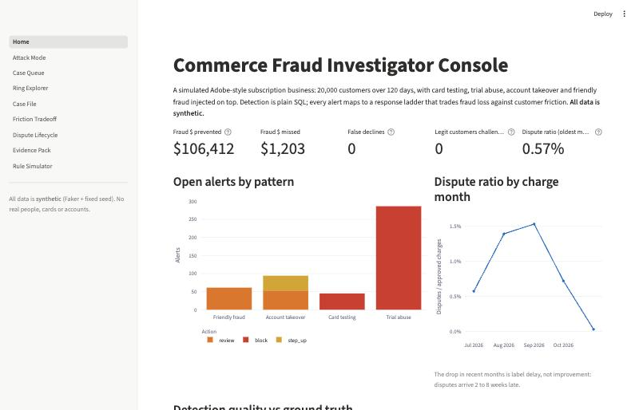
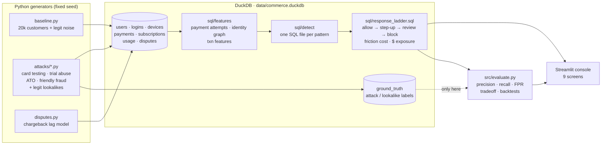
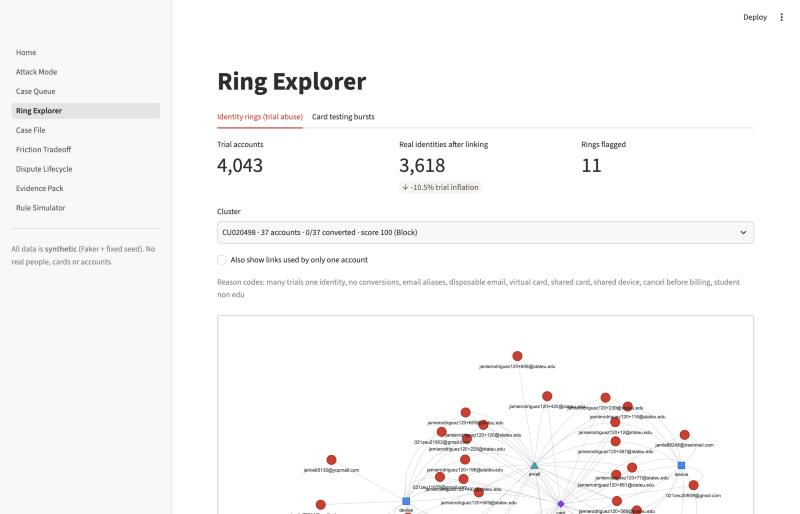
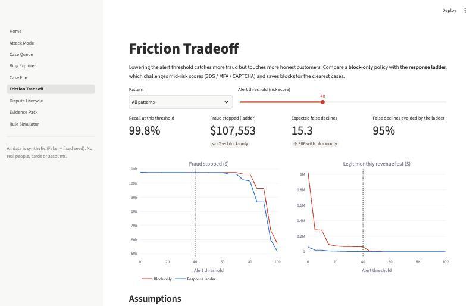

# Commerce Fraud Investigator Console

**▶ Live demo: https://commerce-fraud-console.streamlit.app** (first load can take a minute if the app was asleep)

A working fraud analyst console for a simulated Adobe-style subscription business. It generates realistic customers, payments, logins, trials, product usage and disputes; injects four real-world abuse patterns on demand; detects them in plain SQL; and recommends a response that balances fraud loss against customer friction.

> **All data in this project is synthetic.** It is generated with Faker and a fixed random seed. No real people, cards, accounts or companies' data are involved. "Adobe-style" describes the business model being simulated (Creative Cloud-like plans, trials, student pricing), not Adobe data.



## The problem

Subscription businesses lose money in four very different ways, and each needs a different response:

| Pattern | What happens | Wrong response | Right response |
|---|---|---|---|
| **Card testing** | Stolen cards validated with hundreds of $1 auths, then cashed out days later | Ignore it (fees, issuer penalties) | Block the IP/device, rate limit, block the validated cards |
| **Trial abuse** | One person, 10 to 50 "new" accounts, endless free trials | Ban the person | Collapse identities; require a real card for the next trial |
| **Account takeover** | Leaked password → reset → email change → new card → big purchase | Ban the account (the owner is the victim) | Force MFA, freeze changes, roll back, refund |
| **Friendly fraud** | Real customer uses the product, then disputes the charge as "unauthorized" | Block the customer | Fight the chargeback with evidence |

The hard part isn't catching attacks, it's **not** catching the honest customers who look like them: families on one laptop, travelers, students with plus-addressed emails, a campus network starting trials together, someone retrying a failing card. Every attack injector here also injects those lookalikes, so false positive rates are measured, not assumed.

## Architecture



Rules the code follows:
- **Detection logic lives in SQL**; Python only generates, orchestrates and displays.
- **Detection SQL never reads `ground_truth`.** Only `src/evaluate.py` and tests may (a test greps the SQL to enforce it).
- **Same seed, same world.** Every run, test and demo sees identical data.
- Every detection returns `entity_id, risk_score (0–100), reason_codes, recommended_action`.

## Results (seed 42)

| Pattern | Entity | Attack entities | Recall | Precision | FPR, all legit | Legit lookalikes | FPR, lookalikes |
|---|---|---|---|---|---|---|---|
| Card testing | IP / device | 42 | 1.00 | 1.00 | 0.000 | 402 | 0.000 |
| Trial abuse | account | 268 | 0.99 | 1.00 | 0.000 | 155 | 0.000 |
| Account takeover | account | 94 | 1.00 | 1.00 | 0.000 | 72 | 0.000 |
| Friendly fraud | dispute | 61 | 1.00 | 1.00 | 0.000 | 219 | 0.000 |

The margin matters more than the headline numbers. For each pattern, the weakest attack and the strongest legit entity score:

| Pattern | Lowest attack score | Highest legit score | Alert line |
|---|---|---|---|
| Card testing | 90 | 53 (customer retrying their card 7 times) | 60 |
| Account takeover | 70 | 25 (traveler with a new phone) | 60 |
| Friendly fraud | 90 | 50 (fraud account with its own purchase history) | 60 |
| Trial abuse | 35* | 43 (family sharing a laptop and card) | 60 |

\* The two trial abuse misses each used a fresh device, a fresh card and a throwaway inbox all at once, so nothing links them to the ring. Each explainer in [`docs/explainers.md`](docs/explainers.md) covers what a real team would add to close the gap.

Other headline numbers:
- **Trial inflation:** identity linking collapses 3,983 trial accounts into 3,588 real people (**9.9% inflation**); the 266 flagged abuse accounts are just **10 people**.
- **Card testing cash-out trail:** 871 cards proven live by flagged bursts, 434 later charged from a different IP for **$52.7k**.
- **Response ladder vs block-only:** at an alert threshold of 40, both stop about $103.3k of fraud, but block-only creates **288 false declines** versus **~14** for the ladder (**95% fewer**), and $59.8k versus $3.0k of monthly revenue put at risk.
- **Label delay:** disputes arrive a median 30 days after purchase, so the most recent month shows a dispute ratio near zero. A test checks this.

## Built for learning

The console doubles as a teaching simulator: the whole fraud loop (attack → detect → decide → measure) on safe synthetic data where the answers are known.

- **Learning Guide** page: why the simulator exists, the four attacks at a glance, how the pipeline works, a 12-step guided path with exercises, and a searchable glossary of ~30 fraud and payments terms.
- **Every screen** opens with what it is, why it matters in a real fraud team, how to use it, what to look for, and things to try.
- **💡 lessons** sit next to the key charts and tables, and every Attack Mode slider explains what it changes.
- A **Learning mode** switch in the sidebar hides all of it for a clean demo.

## Screens

| | |
|---|---|
| **Overview:** fraud $ prevented, false declines, dispute ratio, alerts by pattern, detection quality | **Attack Mode:** sliders per attack, launch, detection reruns, shows what fired, how fast, what was missed, which lookalikes were hit |
| **Case Queue:** alerts by risk, reason codes, exposure, analyst decisions | **Ring Explorer:** identity graph of accounts linked by device, card and normalized email; card testing bursts with their cash-outs |
| **Case File:** one account's timeline (logins, events, payments, disputes, usage), linked entities, Approve / Step-up / Review / Block buttons that are logged | **Friction Tradeoff:** threshold slider, block-only vs ladder: fraud stopped vs false declines and revenue lost |
| **Dispute Lifecycle:** lag histogram, label maturity curve, weekly dispute ratio, win rate by reason | **Evidence Pack:** one-click PDF to represent a friendly fraud dispute |
| **Rule Simulator:** write a SQL `WHERE` clause over payment attempts and backtest it | **Intel Brief:** weekly trends by pattern written up as a brief, by template or by Claude |




## Run it

Requires Python 3.11+.

```bash
make setup   # create .venv and install requirements
make all     # generate data, run detection SQL, print evaluation, run tests (~1 minute)
make app     # open the console at http://localhost:8501
```

`make data` builds `data/commerce.duckdb` (20,000 baseline customers plus 34 default attack campaigns). `make detect` runs `sql/features`, then `sql/detect`, then `sql/response_ladder.sql`. `make eval` prints the results table. The app builds the database itself on first start if it doesn't exist.

## Deploy (Streamlit Community Cloud)

1. Push this repo to GitHub.
2. At share.streamlit.io: **New app** → pick the repo → main file `app/Home.py` → Python 3.12 → Deploy.
3. On first boot the app generates the world (about a minute), then it's cached. **Reset world** in Attack Mode regenerates it.

## Repo layout

```
src/generate/baseline.py        legit customers + legit noise
src/generate/attacks/*.py       one injector per pattern, each with legit lookalikes
src/generate/disputes.py        chargeback lag and lifecycle
src/db.py                       DuckDB connection and SQL runner
src/evaluate.py                 precision / recall / FPR, tradeoff, backtests (only reader of ground_truth)
src/evidence_pack.py            friendly fraud representment PDF
sql/schema.sql, sql/macros.sql  tables; email normalization, haversine, travel speed
sql/features/                   payment attempts, identity graph, txn features
sql/detect/                     card_testing, trial_abuse, ato, friendly_fraud
sql/response_ladder.sql         ladder steps, friction, $ exposure, alerts
app/                            Streamlit console (Home + 10 pages)
dbt/                            dbt-duckdb port generated from sql/, with tests and a parity check
splunk/                         log export, props.conf and SPL searches
src/intel_brief.py              weekly metrics + brief writers
src/ieee/, sql/ieee/            IEEE-CIS validation
tests/                          tests: determinism, macros, recall/FPR minimums, ladder, guards
docs/explainers.md              plain-English explainer and interview Q&A for every pattern
```

## Resume bullets

- Built a commerce fraud investigation console (Python, SQL, DuckDB, Streamlit) simulating an Adobe-style subscription business, detecting card testing, account takeover, trial abuse and friendly fraud at 99 to 100% recall with 0% false positives on ~850 deliberately built legit lookalikes
- Collapsed 3,983 "unique" trial accounts into 3,588 real identities via email normalization and device/card graph linking in SQL, exposing 9.9% trial inflation; 266 abusive accounts traced to 10 people
- Designed a response ladder (allow, step-up, review, block) that cut false declines 95% (288 → 14) versus block-only at equal fraud capture

## Phase 2

| Piece | What it is | Status |
|---|---|---|
| **dbt port** (`dbt/`) | All 14 SQL models as a dbt-duckdb project, **generated from `sql/`** so there is one source of truth, with 26 dbt tests. `make dbt` builds it and proves every table matches the plain-SQL pipeline row for row. | Done. The parity check caught two nondeterminism bugs in the original SQL, both fixed |
| **Splunk SPL** (`splunk/`) | JSON event-log export (one sourcetype per stream), `props.conf`, and SPL versions of all four detections, plus a SQL → SPL concept map | Export tested; SPL written but not yet run in a live Splunk |
| **Weekly intel brief** (Intel Brief screen, `make brief`) | Weekly metrics in SQL, written up by a deterministic template or, with an `ANTHROPIC_API_KEY`, by Claude (`claude-opus-5-5`) from the same aggregate numbers only | Done; the Claude writer is tested with a stub client |
| **Threat memo** ([`docs/threat_memo.md`](docs/threat_memo.md)) | Ranked commercial-abuse threats for a creative-software subscription business, with signals, gaps and a 30/60/90 plan | Done |
| **IEEE-CIS validation** (`src/ieee/`, `sql/ieee/`, `make ieee`) | Maps each simulator signal to a real-data proxy and measures lift, coverage and ranking on the Kaggle IEEE-CIS dataset | Pipeline tested on a fixture; needs the Kaggle download to produce real results |

```bash
pip install -r requirements-dev.txt   # dbt-core + dbt-duckdb
make dbt      # regenerate dbt models from sql/, dbt build (models + tests), parity check
make splunk   # export data/splunk/*.json for Splunk
make brief    # print the latest weekly intel brief
make ieee     # after downloading IEEE-CIS into data/ieee/
```
